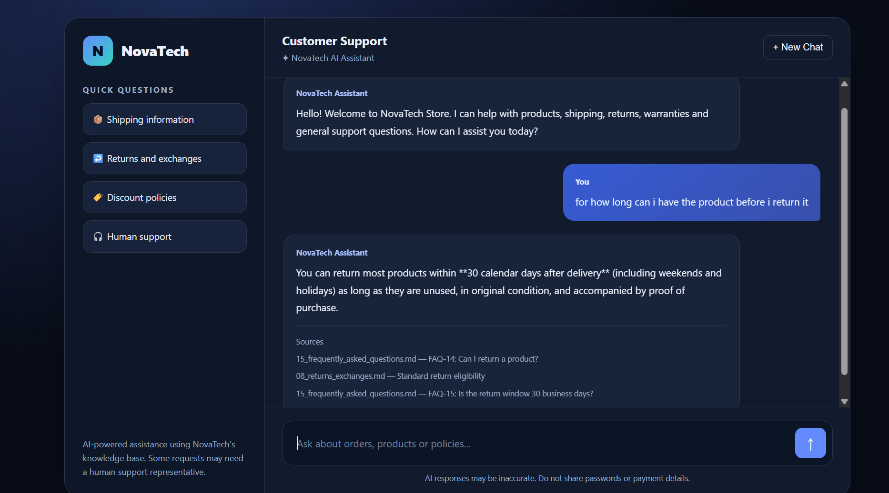
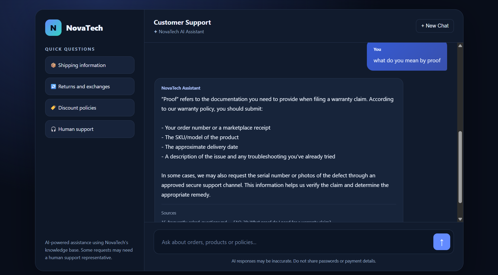
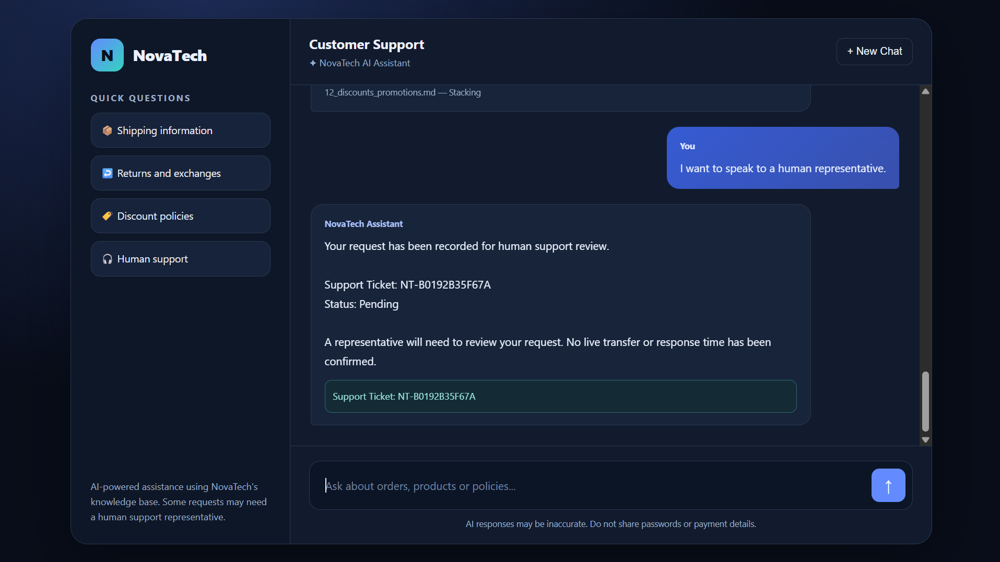
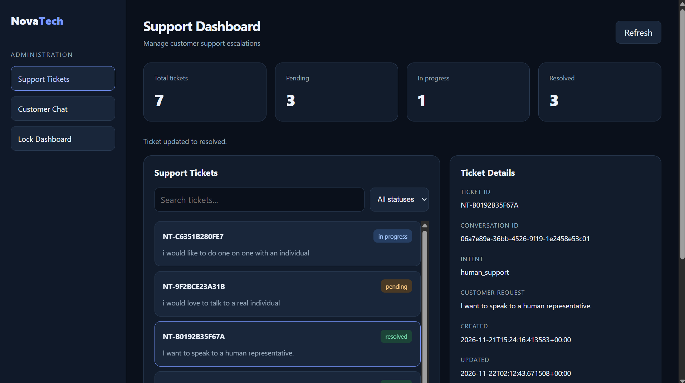
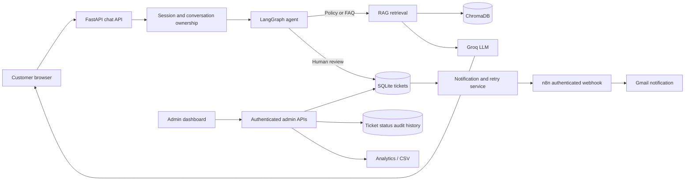

# NovaTech AI Customer Support Agent

**LangGraph · RAG · Groq · ChromaDB · FastAPI · SQLite · n8n**

An end-to-end AI customer-support application for a **fictional electronics retailer, NovaTech Store**. The project combines knowledge-grounded AI responses, routing to human review, a ticket workflow, automated notifications, an administrator interface, support analytics, and evaluation/regression testing.


## What it solves

Retailers handle recurring questions about policies, shipping, returns, warranties and troubleshooting, while customer-specific issues require a human. NovaTech provides a self-service first line of support and a documented escalation pathway without pretending to perform unavailable order-system operations.

## Capabilities

- **RAG knowledge assistant:** retrieves relevant chunks from 18 Markdown knowledge-base documents using ChromaDB and local embeddings; sends retrieved context to a Groq-hosted LLM.
- **LangGraph routing:** classifies customer intent and routes suitable questions to RAG, human-review ticket creation, or safe fallback.
- **Persistent chat memory:** SQLite-backed LangGraph checkpoints keyed by conversation ID.
- **Customer sessions:** HttpOnly cookies, server-generated session IDs, conversation ownership checks and expiry.
- **Support tickets:** SQLite tickets, status transition rules, repeated-request deduplication and an administrative dashboard.
- **Notification automation:** authenticated Python-to-n8n webhook, Gmail notifications, delivery-attempt history, scheduled retries and duplicate-notification controls. Transactional outbox and manual review UI are planned after Step 5.20.
- **Analytics:** counts, status and intent breakdowns, resolution-rate estimates, audited resolution times, date filters and CSV export.
- **Security controls at this stage:** administrator API key, webhook authentication, HttpOnly session cookies and conversation ownership. Full CSRF / host checks, rate limits, security headers and configuration validation are planned in later steps.
- **Evaluation:** labeled customer-support cases, automated routing/outcome/source checks, a saved baseline and a regression checker.

## Application screenshots


### 1. Customer chat — knowledge-grounded answers

The customer interface offers quick questions for shipping, returns, discounts, and human support. Responses draw on NovaTech's knowledge base and display supporting document references. In this example, the assistant explains the return window and cites the relevant FAQ and return-policy documents.



### 2. Context-aware follow-up conversation

Conversations can continue with follow-up questions. This example shows the assistant responding to a question about proof required for a warranty claim. 



### 3. Human-support escalation

A customer can request a human representative. Rather than claiming to connect a live agent, the application creates a support ticket, displays its identifier and pending status, and explains that review is required.



### 4. Administrator support dashboard

The administrator interface shows ticket counts, status filtering, a searchable ticket list and the details of the selected escalation.



## Architecture



See [architecture](docs/architecture.md) for detailed request paths, state management and delivery semantics.

## Technology

| Layer | Implementation |
| --- | --- |
| API | Python, FastAPI, Pydantic |
| Agent | LangGraph, Groq-hosted `openai/gpt-oss-20b` (configured model) |
| Retrieval | LangChain, ChromaDB, local sentence embeddings |
| Persistence | SQLite: tickets, LangGraph checkpoints, sessions, audit events and notification attempts |
| Workflow | n8n + Gmail integration |
| Interfaces | HTML, CSS and vanilla JavaScript |
| Evaluation | JSON test dataset, Python evaluation runner, CSV/JSON outputs and baseline regression checks |

## Local setup (Windows / PowerShell)

1. Clone this repository and enter its root.
2. Create/activate a Python virtual environment and install **the repository's actual** `requirements.txt`.
3. Configure a private `.env` (see [configuration guide](docs/configuration.md)); do not commit secrets.
4. Initialize the Markdown knowledge base and ChromaDB index with the repository's existing ingestion/build scripts. Confirm the vector store is populated.
5. Start your local n8n workflow if you intend to test human escalation notifications.
6. Start FastAPI:

```powershell
python -m uvicorn main:app --reload
```

- Customer: <http://127.0.0.1:8000/>
- Administrator: <http://127.0.0.1:8000/admin>
- Interactive API docs: <http://127.0.0.1:8000/docs>

**Important:** The exact knowledge-base indexing command and dependency versions must be confirmed from the actual repository before a clean-machine setup can be claimed reproducible.

## API

See [docs/api.md](docs/api.md) for routes, authentication and examples. The most common call is `POST /api/chat`, invoked by the browser frontend using its customer-session cookie.

## Evaluation and tests

The implementation includes tests of ticket creation, authorization, sessions, notification retry, reporting and regression-checker logic. These tests have been developed iteratively.

```powershell
python -m scripts.runAgentEvaluation
python -m scripts.checkEvaluationRegression --check
python -m tests.testEvaluationRegression
```

The live evaluation invokes Groq, so it may consume API credits. The regression-checker unit test is deterministic. **Do not publish unverified accuracy percentages.** The initial labeled evaluation is small and still requires manual factual-correctness review. See [docs/evaluation.md](docs/evaluation.md).


## Documentation index

| File | Contents |
| --- | --- |
| [architecture.md](docs/architecture.md) | System components, flows and limitations |
| [api.md](docs/api.md) | Endpoint and authentication reference |
| [configuration.md](docs/configuration.md) | Environment variables and local startup |
| [operations.md](docs/operations.md) | Support ticket, webhook, recovery and administrator procedures |
| [evaluation.md](docs/evaluation.md) | Evaluation dataset, baseline and interpretive cautions |
| [testing.md](docs/testing.md) | Suggested tests and staged quality gates |
| [roadmap.md](docs/roadmap.md) | Completed scope and remaining release milestones |

## Author

[haris-work](https://github.com/haris-work) · [Portfolio](https://haris-work.github.io/my-portfolio/)


