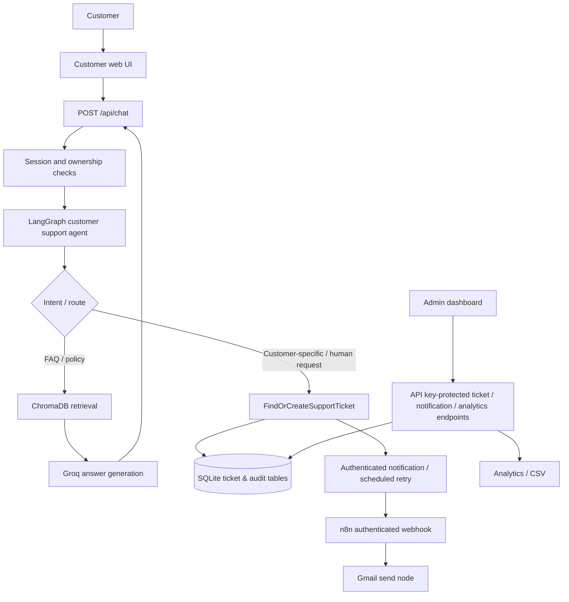

# Architecture and Technical Design

**Documented implementation scope:** development walkthrough through Phase 5, Step 5.20; specifics require comparison with the current repository.

## System context

The system consists of two interfaces: a public fictional customer chat and an administrator dashboard. FastAPI serves the UI and API. LangGraph orchestrates request classification, RAG responses, human escalation and safe fallbacks. SQLite persists conversations and operations. An authenticated n8n workflow sends Gmail notifications for escalations.

## RAG pipeline

1. The fictional retailer's Markdown KB is loaded and chunked by document section with source metadata.
2. ChromaDB stores the embeddings and chunks; retrieval supplies supporting passages.
3. The Groq-hosted LLM generates a response constrained by the retrieved material.
4. The agent reports sources and avoids unsupported assertions when it lacks sufficient evidence.

The initial retrieval evaluation reported an approximate 90% Hit@3 during development. This is **historical testing context**, not a independently reproduced release benchmark. Responses must still be checked against the KB for hallucinations and incorrect promises.

## Conversation management

LangGraph checkpoints persist to SQLite, indexed by a per-conversation `thread_id`. FastAPI issues a separate customer session cookie and maintains a mapping of each conversation ID to a session. A caller supplying another session's conversation ID should be rejected, even if the ID exists.

Implementation caveat: a session cookie represents a browser session, not a verified customer account. Recovery of a conversation after cookie expiry is not implemented as a user sign-in flow.

## Ticket lifecycle

- Typical statuses: `pending` → `in_progress` → `resolved`; re-open transitions are governed by the existing service.
- Duplicate escalations for the same active issue are avoided using conversation ID, intent and a normalized message hash.
- Ticket status transitions are written to audit tables; dedicated notification-review audit actions are planned.
- A shared admin API key identifies the API credential, not the human employee.

## Notification delivery and n8n

At the Step 5.20 cutoff, ticket creation and outbound notification are separate operations. Notification attempts are recorded, n8n confirmation is checked and safe retry logic avoids replaying ambiguous outcomes. A fully transactional outbox is planned for Step 5.23.

**Delivery caveat:** A database commit cannot atomically commit an external Gmail send. Even with outbox, webhook authentication and n8n Data Table deduplication, there are crash windows and manual-review risks. Never represent the system as guaranteeing exactly-once delivery.

## Operations data

SQLite stores ticket records, status audits, delivery attempts and session hashes. A separate SQLite-backed LangGraph checkpoint store holds conversation state. These databases should not be committed to Git.

## Security boundaries

- API key required for administrator operations.
- Secret header required for Python-to-n8n webhook requests.
- Browser session ownership uses an HttpOnly cookie and SameSite setting.
- Origin and host checks, rate limiting and security headers are planned after Step 5.20.

These protections provide defense-in-depth but are not a full security certification. Production deployment requires HTTPS, trusted reverse proxy configuration, staff-specific authorization, secure backup and retention policies, and ongoing monitoring.

## Tradeoffs and limitations

| Decision | Advantage | Limitation |
| --- | --- | --- |
| SQLite | Simple local persistence and atomic writes | Limited write concurrency, backup considerations |
| ChromaDB local embeddings | Local retrieval infrastructure | Model downloads and startup dependencies |
| LangGraph checkpointing | Conversation continuity | Requires session-to-thread access enforcement |
| n8n + Gmail | Easy operational workflow integration | External side effects are not transactional |
| Basic HTML/JS | Lightweight demo | Frontend hardening and accessibility need review |
| Groq LLM | Fast hosted inference | Network/API dependency and variable responses |

## Future work

Transactional outbox, enhanced request security, structured request tracing, backups and recovery tests, Docker packaging, a deployment pipeline and complete acceptance testing remain planned after Step 5.20. GitHub Actions integration belongs to Step 5.21 onward and is **not claimed complete at Step 5.20**.
